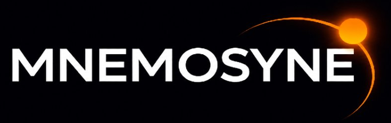

# Mnemosyne — Codebase Memory Graph

> **Persistent memory for engineering teams.** Ingests git commits, recalls bug fixes, synthesizes team rules with Cognee AI, and guards against code regressions.



---

## 🌟 Overview

Mnemosyne solves the "AI assistant amnesia" problem. Modern AI assistants lose context once a chat ends. When team members encounter or fix recurring architectural defects, those lessons are lost in commit logs or PR comments.

Mnemosyne acts as a persistent knowledge graph companion:
- **`remember()`**: Automatically ingests git commit diffs, bug reports, and root causes into an interconnected knowledge graph.
- **`recall()`**: Surfaces historical bug fixes and architectural context before code regressions occur using hybrid graph + vector search.
- **`memify()`**: Periodically clusters and synthesizes recurring patterns into consolidated team rules.
- **`forget()`**: Decays and prunes stale connections when code is refactored or deleted.

---

## 🚀 Key Features

1. **Autonomous Bug Detection & Auto-Fix**: Upload files or scan repositories to detect syntax errors, code quality issues, security vulnerabilities, and historical bug patterns across 5 analysis layers.
2. **Deterministic & AI-Assisted Auto-Repair**: Safe deterministic fixes for bare excepts, unused imports, insecure YAML/subprocess defaults, paired with bounded AI patch generation via Ollama/LLMs.
3. **Automated Verification & Rollback**: Multi-stage verification gates re-parse code, verify defect resolution, check for regressions, execute test suites, and safely rollback failed patches.
4. **Git Pre-Commit Guard**: High-severity vulnerability and syntax blocking hook preventing unsafe code from entering the git repository.
5. **Automated GitHub Integration**: Creates dedicated `mnemosyne/autofix-<id>` branches, commits verified changes, and generates structured Pull Requests with audit summaries.
6. **Continuous Memory Ingestion**: Automatically records verified bug fixes and root causes into Cognee long-term memory to prevent future regressions.
7. **Interactive Knowledge Graph Visualizer**: D3.js-powered relational visualizer mapping tenants, files, bugs, commits, and rules with a detailed node inspector.

---

## 🛠️ Tech Stack

- **Backend**: Python 3.10+, FastAPI, Uvicorn, Typer CLI, Rich, Cognee AI memory engine, Ollama / OpenAI
- **Frontend**: Single-viewport HTML5, CSS3, JavaScript (ES6+), D3.js v7
- **DevOps**: GitPython, GitHub Actions CI/CD, Git hooks
- **Design**: Frosted glassmorphism, retro dot-matrix display typography, high-contrast black headers, full-bleed cybernetic video backdrop

---

## 💻 CLI Commands

```bash
# Scan a specific file or staged changes
python -m mnemosyne.cli scan --file services/user_service.py
python -m mnemosyne.cli scan --staged

# Automatically detect, repair, and verify fixes in a file
python -m mnemosyne.cli autofix --file services/user_service.py

# Run the complete autonomous lifecycle (Scan -> Fix -> Verify -> GitHub PR)
python -m mnemosyne.cli automate --file services/user_service.py --create-pr --branch main

# View recent automation jobs and telemetry
python -m mnemosyne.cli jobs
python -m mnemosyne.cli job <job-id>
```

---

## 📦 Running Locally

1. **Install Dependencies**:
   ```bash
   pip install -r requirements.txt
   pip install pytest
   ```

2. **Start the Mnemosyne Server**:
   ```bash
   python serve.py
   ```

3. **Open in Browser**:
   Navigate to [http://localhost:8085](http://localhost:8085)

4. **Run Automated Test Suite**:
   ```bash
   pytest -v
   ```
